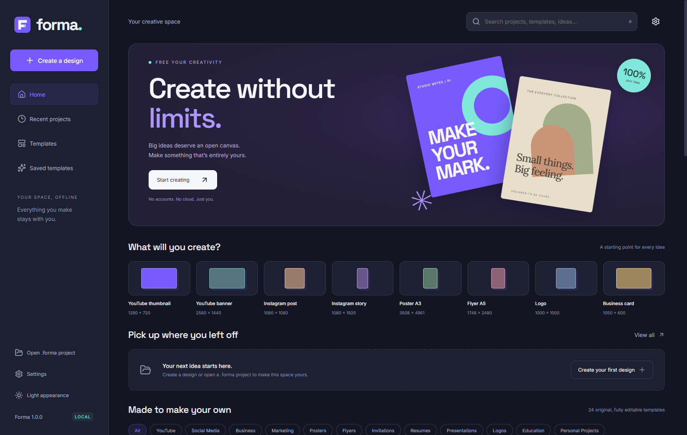
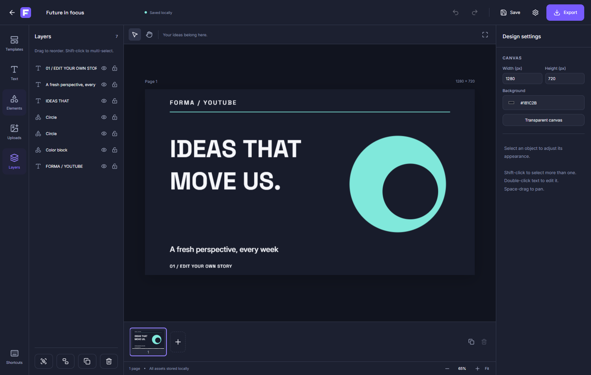

<p align="center"></p>
<h1 align="center">Forma</h1>
<p align="center"><strong>Create without limits.</strong><br/>An independent, free, open-source, offline graphic design studio for Windows.</p>

Forma combines an editable canvas, local project files, original templates and on-device AI background removal. No account, subscription, API key, telemetry or runtime server. Original code, branding and templates are MIT licensed; dependencies retain their own licenses.

**Release status:** local 1.0.0 release candidate; consult the verification record before publishing a stable release. See [release readiness](docs/RELEASE_READINESS.md) for evidence and remaining public-release gates. A successful build does not establish release readiness.




## Features

- Drag, resize, rotate, flip, select multiple objects, group, lock, hide, duplicate, align, distribute and reorder. Undo/redo, context menu, shortcuts, zoom, pan, fullscreen and page backgrounds.
- Layers with synchronized selection, editable names, visibility, locks, type icons and drag ordering.
- Direct text editing, three bundled open font families, imported fonts, spacing, alignment, bullets, numbered text, gradients, outlines, backgrounds and shadows.
- Fifteen original shapes and vector elements, SVG import with sanitization, customizable fills, gradients, borders and shadows.
- Nondestructive crop, masks, brightness, contrast, saturation, exposure, blur, sharpening, grayscale and sepia. Local background replacement and original-image restoration.
- Bundled U²-NetP ONNX segmentation; WebGPU preference with isolated WebAssembly CPU fallback. Erase/restore mask brushes, brush size, mask undo/redo and original/cutout preview. No image uploads.
- Twenty-four original editable templates across twelve categories; save your own templates locally.
- Multiple pages, page thumbnails, duplication, ordering and multipage PDF export.
- Portable `.forma` ZIP projects embed images and imported fonts. Recovery autosaves, close-time recovery, recent projects, rename and duplicate.
- PNG, JPG, SVG (embedded fonts) and raster-page PDF export, quality and scale controls, selected/all pages, ZIP bundles for multiple images or SVGs, and transparency. No watermark.
- Dark and light themes, local settings and no runtime web server.

## Install or run portable

Windows 10 or 11, 64-bit x64; 8 GB RAM recommended for larger projects. A dedicated GPU is optional. Windows ARM64 and 32-bit builds are not included.

Download the verified files from the repository's Releases page once the repository has been published:

1. `Forma-Setup-1.0.0.exe`: run the installer, choose the destination, and start Forma from the Start menu. Uninstall through Windows Settings or the installed uninstaller.
2. `Forma-Portable-1.0.0.exe`: place in a writable folder and run it. Settings and recovery data live in `FormaData` beside the portable executable. Keep that folder when moving the portable app.
3. Compare the download with `SHA256SUMS.txt`: `Get-FileHash .\Forma-Setup-1.0.0.exe -Algorithm SHA256` in PowerShell.

These community executables are **unsigned**. Windows SmartScreen may warn that the publisher is unknown. Verify the source and checksums before choosing to run a build you trust. No code-signing claim is made.

End users do **not** need Node.js, npm, Python or development tools. Everything needed for editing and AI is bundled.

## Make your first design

Create a design from a preset, custom pixel size, or mm/inches at a chosen DPI. Open a template to edit every element. Add local images through Uploads or by dropping files onto the canvas. Double-click text to edit it. Select an image and choose **Remove background** to run local AI, then refine the mask. Save with Ctrl+S and export with Ctrl+E.

Recovery copies are separate from your chosen `.forma` file. Returning Home or closing normally writes the current changes into recovery. A sudden power loss can lose edits since the last recovery interval. Open **Recover autosave** on the dashboard after a crash. Save explicitly to update the file you share or back up.

Removing a dashboard entry offers keeping the saved file or moving it to the Windows Recycle Bin. Both remove its recovery entry; deleting a recovery-only project removes that recovery file. Imported fonts must permit redistribution before you share a `.forma` file or SVG containing them.

## Development

Use Node.js **24 LTS** and npm **11** on Windows. Development downloads dependencies; application operation remains offline.

```powershell
npm ci
npm run assets
npm run lint
npm run typecheck
npm test
npm run build
npm run test:e2e
npm start
```

`npm run dev` builds and launches Electron directly using `file://`. It does not start a local HTTP server. Rebuild/relaunch after source changes. AI and fonts are already checked into this source tree; `assets` verifies them and can restore missing files. The manifest pins their SHA-256 hashes. ONNX Runtime uses bundled WebAssembly binaries with no native AI bindings or runtime downloads.

```powershell
npm run licenses
npm run package
npm run test:packaged
npm run checksums
```

Executables are written to `release/`. Runtime dependencies are packaged by electron-builder; the model and CPU/WebGPU WebAssembly binaries are bundled resources. CI runs on `windows-latest` with pinned Actions commits and a lockfile. See [publishing instructions](docs/PUBLISHING.md).

## Local AI and privacy

The bundled 4.6 MB U²-NetP model was developed by Xuebin Qin and collaborators. See the [upstream model repository](https://github.com/xuebinqin/U-2-Net) and [ONNX artifact distributor](https://github.com/danielgatis/rembg/releases/tag/v0.0.0). Model and paper implementation: Apache-2.0. The exact redistributed artifact is pinned in `assets/manifest.json` and its license is included.

The renderer decodes supported images locally. Automatic mode checks for a WebGPU adapter and runs inference in a browser worker. Unsupported adapters, initialization errors or GPU timeouts fall back to a disposable Node worker using the WebAssembly CPU provider. Both resize RGB input to 320×320, normalize model probabilities and interpolate alpha to the original image dimensions. CPU can be forced in Settings. Jobs have timeouts and memory/pixel limits. All models and runtime binaries are read from bundled local files.

The small model trades detail for CPU speed. Hair, glass, low contrast and crowded scenes can need erase/restore refinement. Original images and adjustment settings stay embedded for nondestructive work. The ONNX Runtime WebAssembly builds contain no telemetry, unlike the native Windows ONNX distribution; see [upstream privacy documentation](https://github.com/microsoft/onnxruntime/blob/v1.30.0/docs/Privacy.md). The inference code contains no network clients. Electron denies remote resource requests and permissions, and the renderer CSP disallows connections.

Installed user data: `%APPDATA%\Forma` (Electron's application user-data directory). Portable data: `FormaData` beside the executable. Project files stay wherever you save them. There are no update checks, analytics or cloud services.

## Contribute and licensing

Read [CONTRIBUTING.md](CONTRIBUTING.md), [CODE_OF_CONDUCT.md](CODE_OF_CONDUCT.md), [SECURITY.md](SECURITY.md), [architecture](docs/ARCHITECTURE.md), [project format](docs/FORMAT.md), and [known limitations](docs/KNOWN_LIMITATIONS.md).

Original Forma source, geometric F logo and original templates: [MIT](LICENSE). Open fonts: SIL OFL 1.1. Lucide: ISC. ONNX Runtime: MIT. U²-NetP: Apache-2.0. See [THIRD_PARTY_NOTICES.md](THIRD_PARTY_NOTICES.md) and `licenses/` for the full dependency inventory and notices. No Canva code, private APIs or assets are used.

